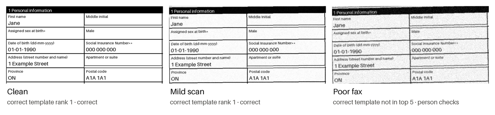

# Which form is this? A MinHash shortlist PoC

A follow-up experiment to a technical discussion about matching scanned enrolment forms to their templates.
It records what I tested and what I learned, using synthetic forms only. It is not a product: it hasn't been
validated on real forms or at the scale of a 20,000-form library. Developed with
[Claude Code](https://claude.com/claude-code).

It is a small, reproducible template-matching experiment for one question in document intake:

> When a scanned form arrives, can MinHash reliably shortlist the template it was filled on, including
> near-identical versions of the same form?

**Finding:** in this experiment, MinHash shortlisted well on readable scans. But near-identical known and
unregistered versions received similar scores, so similarity alone was not enough to pick the template.

- **Shortlisting:** on clean and mildly degraded scans, the correct template ranked first among 506 every time.
- **The unregistered version:** a newer version that isn't in the library scored about like a known form
  (MinHash similarity 0.88 vs 0.88, verify margin 0.08 vs 0.08).
- **With the printed-code check:** an extra check that requires strong content evidence and agreement with
  the form code printed on the page accepted **6 of 8 known forms, with 0 wrong accepts among these 10
  synthetic cases**. The rest went to a person.

The PoC returns a **template identifier** (for example `K41M2.01 DCPP E-07-25`). It doesn't include a
JSON-schema registry. In a real integration, each registered template ID would map to its schema. All data is
synthetic (see [Data and privacy](#data-and-privacy)), and every number below comes from running this folder's
code.


## Results



**The library (506 templates):**
- 6 built around one fictional client's pension enrolment form:
  - current version
  - older version
  - plan 02
  - another client with the same fund list
  - a Group RRSP form
  - a beneficiary change form
- 500 seeded lookalike DCPP/GRSP templates from other fictional clients.

**The test forms:** ten were filled in, rendered, degraded to a set scan quality, and read back by OCR.

**What happened:**
- **Shortlisting on readable scans:** for all 6 clean or mildly degraded forms whose template is in the
  library, the correct template ranked first.
- **MinHash alone sent close versions to review.** The current and older versions led their near-twin by only
  0.08 to 0.09, below the 0.20 margin. Forms that differ more (other plan, other client, other product) were
  accepted.
- **The printed code settled the close calls only where content was strong.** The combined rule accepts only
  if three things hold:
  - the winner's verify score is at least 0.75;
  - every form code read from the page footers is the same code;
  - that code matches the winner.

  A matching code takes the place of the margin requirement, but not the score requirement. Weak content
  with a matching footer still goes to review.
- **Forms the library doesn't contain were not accepted.** The unregistered new version went to review,
  because its printed code doesn't match the content winner. The unrelated dental claim was classed as
  unknown.
- **Poor fax quality is where it broke.** OCR recovered under a fifth of the labels, the correct template
  dropped out of the shortlist, and no code was readable. Those forms went to a person, which is safe but not
  useful.


**Why similarity alone didn't decide here.** After verification, the two correct near-identical matches led
their runner-up by 0.08 and 0.09, and the unregistered version led by 0.08 (shaded rows). In these cases, any
margin threshold low enough to accept the known versions would also have accepted the unregistered one. The
printed form code is what separated them.



*The three scan qualities used in the tests. Poor fax is still readable by a person but costs OCR most of
the text.*

## How it works

1. **Fingerprint.** Each OCR line is lower-cased, stripped of spaces and punctuation (OCR often drops spaces,
   e.g. "ContributionPensionPlan"), and cut into overlapping 5-character pieces called shingles. Common OCR
   confusions are folded on both sides (o/0, i/l/1, s/5). Footer lines with the form code are left out, so
   similarity measures content only.
2. **Shortlist.** Each template gets a 128-number MinHash signature, a compact sketch whose agreement estimates
   how much two shingle sets overlap (Jaccard similarity). The scan's signature is compared with every
   template's in one array operation, and the top 5 are kept. This experiment uses 506 templates.
   - At 20,000 templates the signatures would take about 20 MB (20,000 × 128 × 8 bytes). Comparison time at
     that size wasn't measured here.
   - Whether an index such as LSH is worth adding depends on library size, latency targets, throughput,
     hardware and retrieval quality.
3. **Verify.** For the 5 candidates, exact sets are compared, counting only the shingles that differ between
   them (plan number, fund line-up, client name). A candidate scores well if its own distinguishing labels
   are in the scan and it explains most of the scan's distinguishing labels.
4. **MinHash-only decision.** These thresholds were fixed before the first run and not tuned to the results:
   - *unknown* if less than half of the best template's labels are found
   - *accept* if the verify score is at least 0.75 and leads the runner-up by at least 0.20
   - *review* otherwise
5. **Combined rule (the design tested here).**
   - The content gate must pass.
   - The winner's unrounded verify score must be at least 0.75.
   - Every printed form code found must be the same code (ignoring spaces and 0/O, 1/I/l confusions), and it
     must match the winner.
   - If those hold, the code takes the place of the margin requirement.
   - Otherwise the form goes to review, with a recorded reason: `code_conflict`, `code_disagrees`,
     `code_unreadable`, `below_accept_score` or `no_readable_text`.

   The code pattern fits this synthetic library's codes. It isn't a general parser for any insurer's
   identifiers.

There is no LLM in the loop. OCR is a local ONNX model ([RapidOCR](https://github.com/RapidAI/RapidOCR)), and
similarity and decisions are plain deterministic code. With Python 3.12 and the pinned packages, results and
OCR text were byte-identical on macOS x86_64 and Linux x86_64 (Docker). OCR may differ slightly on other CPU
architectures (see the runbook).

### How the test data is separated

- **Library:** each blank form's label text, written as source in [forms.py](forms.py). It stands in for a
  blank PDF's text layer.
- **Test forms:** filled in from the same synthetic label definitions, then rendered, degraded and OCR'd.

The two share label definitions but never OCR output. So this tests robustness to rendering, scanning and
OCR. It isn't an independently collected real-world dataset.

## Compared with embedding search (not tested here)

An alternative design:
1. Embed the blank forms' labels and structure.
2. Store the vectors in a vector database such as Qdrant, together with template ID, version and schema
   reference.
3. Retrieve a shortlist for each incoming form.
4. Verify the distinguishing fields before choosing the schema.

No embedding baseline was implemented, so this PoC doesn't compare the two. Possible trade-offs to test:

- **Retrieval:** dense embeddings may tolerate reworded or reordered labels better. Multilingual or
  image-aware models may help with French versions or layout. MinHash only sees exact text.
- **Near-identical versions:** whether an embedding separates "2060" vs "2065" funds, or plan "01" vs "02",
  is an open question that would need measuring on the same cases.
- **Operations:** a vector database adds metadata filters (client, language, active versions) and an
  embedding model to host. MinHash signatures are a plain array, and the labels that matched can be listed.

Both designs share the step this PoC investigates: retrieve candidates, then verify before choosing. Here,
that verification is exact and rule-based (distinguishing labels plus the printed form code). That is the
design tested in this PoC, not a requirement proven for every retrieval method.

## Limitations

- **Small, synthetic test set:** 10 test forms and 500 generated lookalikes. Zero wrong accepts here is not
  a production error rate. Real form libraries will have other kinds of near-duplicates.
- **Uncalibrated thresholds:** they were set before running, not fitted, and would need calibrating on real
  scans.
- **Hand-written labels:** the library's label text is written by hand, not extracted from real blank PDFs.
  Long legal paragraphs are left out on purpose.
- **OCR is the bottleneck on bad scans:** a stronger OCR engine, or asking for a rescan, would change the
  poor-fax rows.
- **The combined rule needs a readable printed code.** Forms without one always go to review under this rule.
  The content gate is not a check that every page is present.
- **No schema lookup:** the output is a template ID; mapping it to a JSON schema is left to an integration.
- **Platform coverage:** verified on macOS x86_64 and Linux x86_64 (Docker) with Python 3.12. Windows and
  ARM haven't been run.

## Try it

From this folder (the repository root):

```bash
python3.12 -m venv .venv && .venv/bin/pip install -r requirements.txt
.venv/bin/python -m unittest discover -s tests     # 17 fast checks, a few seconds, no OCR
.venv/bin/python -I run.py                         # full run, about 1.5 to 3 minutes
.venv/bin/python -I make_figures.py                # rebuild the charts in docs/ from the run
```

`run.py` exits with an error if any test case doesn't get its intended decision (`INTENDED` in `forms.py`)
or if any form is accepted as the wrong template.

Or with Docker, from the same folder: `docker build -t form-shortlist-poc . && docker run --rm form-shortlist-poc`.
[RUNBOOK.md](RUNBOOK.md) covers setup on macOS, Linux and Windows, expected output, how to change the test
set, and troubleshooting.

## Data and privacy

Everything in this repository is synthetic:

- **Insurer:** "Example Life"
- **Plan sponsors:** "Maple Example Corp." and "Birch Sample Holdings Ltd."
- **Funds, form codes and the 500 lookalike clients:** fictional and generated.
- **The test member:** placeholder values ("Jane Sample", SIN `000 000 000`, `jane.sample@example.com`,
  postal code `A1A 1A1`).

No real form, company document or personal information is included, and none is needed to reproduce the
results.

## Files

| Path | What it is |
|---|---|
| `run.py` | Runs everything; writes `out/report.txt` and `out/results.json`; checks intended decisions |
| `forms.py` | Template library, test forms and their intended decisions, page rendering, scan degradation |
| `shortlist.py` | Shingles, MinHash, verification, decision rules, printed-code checks |
| `ocr.py` | RapidOCR wrapper (models ship inside the pip package) |
| `make_figures.py` | Builds `docs/results.svg`, `docs/margins.svg` and `docs/scan-quality.png` from a run |
| `docs/` | Figures used in this README (`pipeline.svg` is hand-drawn) |
| `tests/test_shortlist.py` | Fast checks: determinism, decision rules, empty input, code conflicts (no OCR) |
| `data/funds.json` | The fictional fund list used on the forms |
| `requirements.txt` | Exact package versions |
| `Dockerfile` | Optional Linux environment (base image pinned by digest) |
| `RUNBOOK.md` | Setup, run, verify, change, troubleshoot |
